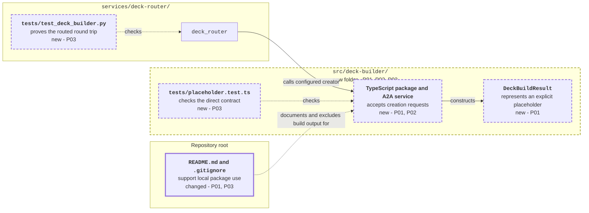

<!-- markdownlint-disable-file -->
# RPI Plan: TypeScript deck-builder A2A placeholder

## Task Metadata

* Task ID: `deck-builder-a2a-placeholder`
* Task slug: `deck-builder-a2a-placeholder`
* Plan date: `2026-11-20`
* Planning context: standalone `/hve-core:rpi-plan`; planning only
* Active invocation: standalone `/hve-core:rpi-implement`; full plan

## Executive Summary

The independently runnable TypeScript package under [src/deck-builder](../../../src/deck-builder)
is implemented. The unchanged Python router calls it through A2A and relays a serialized
`DeckBuildResult` containing `status`, `request`, and `message`. The result will
explicitly say that generation is not implemented. No slides or PPTX files are made.

The package and class, official-SDK A2A endpoint, focused tests and setup
documentation are complete. Verification includes direct requests and a
model-free Python-to-Node router round trip.
Existing routing, editing, and the echo mock remain unchanged.

Planning is complete. The standard critique's one Medium validation-command
finding is resolved; there were no Critical or High findings.

Implementation is complete for the full plan; all markers are checked.
Node `26.13.1` and npm `11.20.0` are available through a
process-local fnm PATH. All six Node cases, the real model-free Python-to-Node
round trip, 62 isolated router regressions and required static checks pass.
Four existing opt-in cases were skipped as intended. No paid calls were made.
The scope is ready for optional Review, which has not been invoked.

### What You May Not Know

* The existing router is Python, discovers downstream Agent Cards, and invokes
  same-origin JSON-RPC A2A endpoints. A local TypeScript class alone is not callable
  by that router.
* Keep npm local to [src/deck-builder/package.json](../../../src/deck-builder/package.json)
  rather than introducing a repository-wide Node workspace.
* The router relays application data without translating worker schemas. A
  TypeScript class must serialize to structured data over A2A; callers do not
  receive a live JavaScript class instance.
* Both creator and editor must be discoverable for a new routed request. Adding
  a creator does not replace the editor.
* Published `@a2a-js/sdk@1.3.0` supports native A2A 1.0, matching the router.
  Its protobuf-style internal TypeScript types differ from its wire JSON.
* Fresh tool processes need the user-provided fnm directory on process-local
  PATH; the existing Node/npm installation was verified without a system change.

## Phase Checklist

### After



Key: arrows point from a part to what it uses; dotted arrows, tests and docs;
dashed border, new; thick border, changed; each tag names its phases.

The existing router calls the new TypeScript package (P01, P02), whose executor
constructs `DeckBuildResult` (P01). Direct and routed tests prove that boundary
(P03); root ignore rules and usage documentation support the package (P01, P03).
This adds a creator without removing or replacing an existing code connection,
so no Before map is needed.

<!-- rpi:phase id=P01 -->
### [x] P01: Establish the typed package boundary

Goals:
* Provide an independently buildable TypeScript package and a small public result
  class that can survive replacement of placeholder logic with real generation.

Dependencies:
* None for design; compatible Node and npm must be available before commands run.

Changes in the map: adds TypeScript package configuration and `DeckBuildResult`;
updates root ignore rules for Node dependencies.

<!-- rpi:task id=P01-T01 -->
#### [x] P01-T01: Define the package and result contract

Goals:
* Consumers can import the result class and build/type-check the package without
  changing the Python workspace.

Requirements:
* `FR-002`, `FR-003`, `NFR-001`, `NFR-003`, `NFR-004`.
* The class's serialized application object has exactly this shape:

```ts
{
  status: "placeholder";
  request: string;
  message: string;
}
```

Details:
* Canonical targets: [src/deck-builder/package.json](../../../src/deck-builder/package.json),
  [src/deck-builder/package-lock.json](../../../src/deck-builder/package-lock.json),
  [src/deck-builder/tsconfig.json](../../../src/deck-builder/tsconfig.json),
  [src/deck-builder/result.ts](../../../src/deck-builder/result.ts), and
  [src/deck-builder/index.ts](../../../src/deck-builder/index.ts). Export the
  actual `DeckBuildResult` class through the package entry point; importing it
  must not start a listener.
* Use ESM and strict TypeScript with the official `@a2a-js/sdk` pinned to `1.3.0`
  and an Express version satisfying its published peer range. Add only TypeScript,
  Node/Express types, and necessary runtime peers. No slide, model, database,
  bundler, monorepo, or additional test-runner dependencies.
* Required scripts: `build`, `typecheck`, `test`, and `start`. Use TypeScript
  compilation and Node's built-in test runner. `start` runs the compiled
  `server.js`; `test` builds then runs the compiled focused test file.
* Keep source and test TypeScript type-checked; output goes only to the package's
  `dist` directory. Add `node_modules/` to root ignore rules; existing `dist/`
  already excludes compiled output. Do not ignore or hand-author the lockfile.
* Node must satisfy the SDK's `>=20` engine requirement; prefer a currently
  supported LTS supplied by the user. Verify `node --version` and `npm --version`
  in a fresh shell. Do not install system runtimes as part of this implementation.
* Create the dependency manifest before using npm to resolve dependencies and
  generate its lockfile. No repository-root npm workspace is required.

References:
* [pyproject.toml](../../../pyproject.toml): existing Python-only workspace.
* [.gitignore](../../../.gitignore): existing generated-output exclusions.
* [.copilot-tracking/research/2026-11-20/deck-builder-a2a-placeholder-research.md](../../research/2026-11-20/deck-builder-a2a-placeholder-research.md): Q1 and findings on SDK exports, runtime and codecs; W3-W12.

Dependencies:
* None.

<!-- rpi:phase id=P02 -->
### [x] P02: Expose the callable A2A placeholder

Goals:
* A configured creator URL accepts the routed user request and returns an
  immediate, honest placeholder result without adding generation or task state.

Dependencies:
* P01.

Changes in the map: adds the A2A runtime to the TypeScript package.

<!-- rpi:task id=P02-T01 -->
#### [x] P02-T01: Serve discovery and immediate structured results

Goals:
* The Python router can discover and call the creator using its current transport
  and receive the defined application data unchanged.

Requirements:
* `FR-001`, `FR-002`, `FR-003`, `FR-004`, `FR-005`, `FR-006`, `NFR-001`,
  `NFR-002`, `NFR-003`, `NFR-004`.
* Expose `GET /ping`, `GET /.well-known/agent-card.json`, and native A2A 1.0
  JSON-RPC `POST /` with `SendMessage` and `A2A-Version: 1.0`.
* For accepted input, `result.message.parts` contains one structured data part
  whose `data` is exactly the P01 contract. The message has agent role, a
  nonempty generated message ID, and the SDK context ID. No task, artifact,
  file, extra application fields, or additional response parts.

Details:
* Canonical targets: [src/deck-builder/executor.ts](../../../src/deck-builder/executor.ts),
  [src/deck-builder/app.ts](../../../src/deck-builder/app.ts), and
  [src/deck-builder/server.ts](../../../src/deck-builder/server.ts);
  extend [src/deck-builder/index.ts](../../../src/deck-builder/index.ts) only for intentional public exports. Keep listener startup
  separate from app/executor construction for testing and package imports.
* Compose the official `AgentExecutor`, `DefaultRequestHandler`,
  `InMemoryTaskStore`, `agentCardHandler`, and `jsonRpcHandler`. Use public SDK
  types/codecs and `AgentEvent.message`; do not implement protocol dispatch or
  use obsolete 0.3 helpers. Finish the immediate SDK event lifecycle so requests
  terminate; no workflow state or custom task store.
* Validate the message at the request-handler boundary before delegating to
  `DefaultRequestHandler.sendMessage`: runtime evidence shows executor errors
  otherwise become failed tasks containing input history instead of JSON-RPC
  errors. A narrow subclass preserves SDK dispatch/serialization. Reject task
  listing and streaming rather than exposing unsupported placeholder workflows.
* Advertise one `create-deck` skill describing creation intent and explicitly
  identifying placeholder readiness. Do not advertise editing, streaming, push
  notifications, or generated PPTX output. Input modes cover text, JSON and file
  attachments; output is `application/json`.
* Join all text parts with `"\n"` in their original order, preserving content and
  whitespace in `request`; trimming is only for the empty-input guard. Reject
  non-user messages and whitespace-only/missing text with explicit SDK
  invalid-request/parameter errors, never a successful placeholder.
* Instantiate `DeckBuildResult` for every accepted request. Set `message` to a
  clear statement that deck generation is not implemented. Explicitly serialize
  it to the SDK structured-data representation; the class is an application
  contract, not a JavaScript instance sent over HTTP.
* Accept additional data/raw-file/URL parts but do not parse, echo, persist,
  download, or execute them. Do not include them in the result.
* Bind only to `127.0.0.1`. Default port: `8001`; optional process environment
  `DECK_BUILDER_PORT` selects an integer from `1` to `65535`. An explicit invalid
  value is a startup error, not a silent fallback. Derive the advertised origin
  from that port, avoiding a separate public-URL configuration.
* Process environment is sufficient; do not read secrets or introduce a second
  dotenv loader. Document configuring `DECK_ROUTER_CREATOR_URL` to that exact
  origin. The editor URL stays independently configured.
* Keep failures in SDK error envelopes. Unsupported task operations must not
  return success; use SDK unsupported/task-not-found semantics. Surface startup
  failures with a nonzero exit; do not log user text, attachments, or credentials.

References:
* [services/deck-router/src/deck_router/downstream.py](../../../services/deck-router/src/deck_router/downstream.py): same-origin `JSONRPC` card filtering and client construction.
* [services/deck-router/src/deck_router/handler.py](../../../services/deck-router/src/deck_router/handler.py): original request forwarding, message wrapping and unchanged application data.
* [services/deck-router/src/downstream_mock/api.py](../../../services/deck-router/src/downstream_mock/api.py): immediate-message local-service precedent; preserve it unchanged.
* [.copilot-tracking/research/2026-11-20/deck-builder-a2a-placeholder-research.md](../../research/2026-11-20/deck-builder-a2a-placeholder-research.md): Q1-Q3; W4-W12 establish the native SDK surface.

Dependencies:
* P01-T01.

<!-- rpi:phase id=P03 -->
### [x] P03: Prove and document the local router boundary

Goals:
* Focused tests establish actual TypeScript/Python interoperability and precise
  placeholder behavior, while users can run it without confusing it with generation.

Dependencies:
* P02.

Changes in the map: adds direct Node tests and the Python router integration test;
updates the root usage documentation.

<!-- rpi:task id=P03-T01 -->
#### [x] P03-T01: Verify direct behavior and the real routed round trip

Goals:
* Tests prove the agreed response on both the service's HTTP boundary and the
  existing router's real outbound SDK path, without paid model calls.

Requirements:
* `FR-001`, `FR-002`, `FR-003`, `FR-004`, `FR-005`, `FR-006`, `NFR-001`,
  `NFR-002`, `NFR-003`, `NFR-004`.
* The cross-language check must reach a real compiled Node service over loopback;
  replacing the creator with a canned HTTP response is not equivalent evidence.

Details:
* Test ownership: [src/deck-builder/tests/placeholder.test.ts](../../../src/deck-builder/tests/placeholder.test.ts)
  owns Node/service semantics;
  [services/deck-router/tests/test_deck_builder.py](../../../services/deck-router/tests/test_deck_builder.py) owns one
  cross-language round trip. No existing tests are removed or renamed.
* Maximum additions: seven executable cases total, counting parameterized cases:
  six Node cases and one Python integration case. Avoid asserting SDK/framework
  internals, trivial class accessors, or constants without observable behavior.
* Node cases: configured-origin discovery plus health and truthful creator-only
  capabilities; mixed multiline text/data/file/URL request producing exact result
  JSON and no files; whitespace-only instructions rejected; non-user role rejected;
  invalid port rejected without fallback; unsupported task operation yields an
  error rather than a placeholder. Public class export must be type-checked and
  imported without listener side effects within these cases, not a separate case.
* The Python case uses `create_app` with an injected deterministic create
  selector, both discoverable workers, and synthetic text plus an attachment.
  The creator is the actual Node process; the existing echo mock supplies the
  editor discovery boundary locally. Assert no JSON-RPC error, exact unmodified
  `DeckBuildResult` data, and the router's creator-affinity context ID.
* Keep the new Python integration opt-in using
  `DECK_ROUTER_BUILDER_INTEGRATION_TESTS=1`, so the existing Python suite still
  runs without Node. An opted-in run must fail clearly on missing runtime/build,
  bad startup, or unavailable service; it must not skip or call a model.
* Use isolated loopback ports, bounded readiness polling and request timeouts,
  temporary process environment, and guaranteed cleanup of only test-owned
  listeners/child PIDs. Do not modify the real root `.env`, use existing servers,
  terminate processes by name, or run opted-in paid tests.
* Semantic evidence: exact part shape/text preservation, explicit non-generation,
  invalid-input errors, truthful discovery, configuration failure, and real SDK
  round trip. Regression evidence: unchanged router/mock suite and Python checks.
* Commands from the workspace root after manifest/lock creation:

```powershell
node --version
npm --version
npm --prefix src\deck-builder ci
npm --prefix src\deck-builder run typecheck
npm --prefix src\deck-builder run build
npm --prefix src\deck-builder test
$priorBuilderFlag = [Environment]::GetEnvironmentVariable(
    "DECK_ROUTER_BUILDER_INTEGRATION_TESTS", "Process")
$priorLiveFlag = [Environment]::GetEnvironmentVariable(
    "DECK_ROUTER_LIVE_DECISION_TESTS", "Process")
try {
    $env:DECK_ROUTER_LIVE_DECISION_TESTS = "0"
    $env:DECK_ROUTER_BUILDER_INTEGRATION_TESTS = "1"
    uv run --all-packages pytest services\deck-router\tests\test_deck_builder.py -q
    if ($LASTEXITCODE -ne 0) { throw "Builder integration failed" }
    $env:DECK_ROUTER_BUILDER_INTEGRATION_TESTS = "0"
    uv run --all-packages python -c "import os, pytest; os.environ.update(DECK_ROUTER_CREATOR_URL='', DECK_ROUTER_EDITOR_URL=''); raise SystemExit(pytest.main([r'services\deck-router\tests']))"
    if ($LASTEXITCODE -ne 0) { throw "Router regression suite failed" }
} finally {
    [Environment]::SetEnvironmentVariable(
        "DECK_ROUTER_BUILDER_INTEGRATION_TESTS", $priorBuilderFlag, "Process")
    [Environment]::SetEnvironmentVariable(
        "DECK_ROUTER_LIVE_DECISION_TESTS", $priorLiveFlag, "Process")
}
uv run --all-packages ruff check services\deck-router\tests\test_deck_builder.py
uv run --all-packages ruff format --check services\deck-router\tests\test_deck_builder.py
uv run --all-packages ty check
```

* The command block disables paid live tests, runs the builder integration once,
  and restores both prior flags, including absence, even on failure. If a Python
  command fails specifically on missing dependencies, restore with the documented
  `uv sync --all-packages --locked` before rerunning, without changing `uv.lock`.
* The regression-only Python process clears both downstream URL settings to
  override ambient dotenv configuration. This preserves the existing
  unconfigured-service test without reading or modifying the real `.env`.
* Record actual outcomes and limitations in the downstream changes record.
  Planning's source inspection is not substitute runtime evidence.

Guidance:
* `createApp(port)` in [src/deck-builder/app.ts](../../../src/deck-builder/app.ts)
  advertises the supplied loopback port. A Node test can bind an owned HTTP
  server to port zero, obtain its actual port, then attach this configured app.

References:
* [services/deck-router/tests/test_downstream_mock.py](../../../services/deck-router/tests/test_downstream_mock.py): deterministic selector, mixed parts, context assertions and opt-in precedent.
* [services/deck-router/src/deck_router/app.py](../../../services/deck-router/src/deck_router/app.py): injectable selector and HTTP client.
* [README.md](../../../README.md): existing model-free suite and Python checks.
* [.copilot-tracking/research/2026-11-20/deck-builder-a2a-placeholder-research.md](../../research/2026-11-20/deck-builder-a2a-placeholder-research.md): planning-time SDK evidence; executed results are in the changes record.

Dependencies:
* P02-T01.

<!-- rpi:task id=P03-T02 -->
#### [x] P03-T02: Document setup and the placeholder contract

Goals:
* A developer can run the creator, connect it to the router, and recognize that
  the response is a typed placeholder rather than a generated presentation.

Requirements:
* `FR-002`, `FR-003`, `FR-004`, `NFR-002`, `NFR-003`, `NFR-004`.

Details:
* Update the existing root README only; do not add another package README.
  Amend the claim that no creator implementation exists to distinguish the new
  placeholder from real generation. Preserve existing editor/mock instructions.
* Document Node/npm prerequisites, package-local `npm ci`, build, type-check,
  start and test commands, listener/port defaults, and the exact result example.
* Document the creator URL setting and a separately discoverable editor
  requirement. Do not imply the builder implements editing or bypasses the
  router's model selection in normal operation.
* Explain ignored attachments, unsupported task workflows, local-only/no-auth
  posture, and why a class becomes JSON over A2A.
* Document the deterministic opt-in integration test and distinguish it from
  existing optional paid Decision-1 tests. No changes to the user's real `.env`.

References:
* [README.md](../../../README.md): canonical setup, API, model behavior and verification.
* [services/deck-router/src/deck_router/utils/settings.py](../../../services/deck-router/src/deck_router/utils/settings.py): existing creator/editor configuration.

Dependencies:
* P02-T01 for commands and contract; P03-T01 for verified test instructions.

## User Decisions and Requirements

### Confirmed User Direction

* Create a deck-builder A2A package in `src`.
* Use TypeScript to allow future JavaScript-package integrations.
* The router will forward the user's request to this agent.
* Return a standard defined class.
* Implement only a placeholder in the later implementation stage.
* The original invocation requested planning; the later implementation invocation
  explicitly requests implementation of the full plan.
* D1 answer: the placeholder must be a runnable A2A service callable by the existing router.
* D2 answer: use `DeckBuildResult` with `status: "placeholder"`, `request: string`,
  and `message: string`. Join incoming text parts with newlines; explain that deck
  generation is not implemented. Attachments are accepted but not processed.
* User follow-up: "let me install npm on the side". Continue planning without
  installing a system runtime; implementation will verify Node/npm availability.
* Implementation invocation: "yes node 26 npm v11 is available". Implement the
  full plan; locate the existing runtime rather than installing another one.

### Planning Decisions and Feedback

| Group | Decision or feedback item | Status | Owner | Rationale or input needed | Evidence | Planning impact |
|-------|---------------------------|--------|-------|---------------------------|----------|-----------------|
| D1 | Runnable A2A placeholder versus package scaffold only | Confirmed | User | User selected "Runnable A2A service with placeholder behavior" through the question tool | [services/deck-router/src/deck_router/downstream.py](../../../services/deck-router/src/deck_router/downstream.py) | `P02-T01`, `FR-001`, `FR-004` require callable transport and interoperability |
| D2 | Standard result class and JSON shape | Confirmed | User | User selected "Use the proposed DeckBuildResult: status, request, message" through the question tool | [services/deck-router/src/downstream_mock/api.py](../../../services/deck-router/src/downstream_mock/api.py) | `P01-T01`, `P02-T01`, `P03-T01` use the agreed contract |

No material user choices remain unresolved. Planning extensions were considered:
architecture/security/performance planners do not apply to this bounded local
placeholder. No planning subagent was needed; standard critique is complete and
its only finding is resolved.

## Planning Readiness and Next Step

| Field | Record |
|-------|--------|
| Planning execution and readiness | Complete; approved scope and resolved critique retained |
| Implementation execution and review readiness | Complete for the full plan; Ready for optional Review |
| Decision participation | `user-owned`; standalone invocation |
| Blockers | None; runtime prerequisite satisfied and required checks passed |
| Latest critique | [.copilot-tracking/reviews/plans/2026-11-20/deck-builder-a2a-placeholder-plan-critique.md](../../reviews/plans/2026-11-20/deck-builder-a2a-placeholder-plan-critique.md); Complete execution, Revise verdict, one Medium finding |
| Relevant research | [.copilot-tracking/research/2026-11-20/deck-builder-a2a-placeholder-research.md](../../research/2026-11-20/deck-builder-a2a-placeholder-research.md); complete and supports planning |
| Plan | [.copilot-tracking/plans/2026-11-20/deck-builder-a2a-placeholder-plan.md](deck-builder-a2a-placeholder-plan.md) |
| Changes-record role | [.copilot-tracking/changes/2026-11-20/deck-builder-a2a-placeholder-changes.md](../../changes/2026-11-20/deck-builder-a2a-placeholder-changes.md) holds implementation evidence |
| Continuation owner | User |
| Required gates or confirmations | D1/D2 answered; all tasks verified; critique complete and PC-001 resolved; no unresolved user decisions |
| Next action | Optional `/rpi-review` using this plan and the changes record |

## Goals

* Establish a small, typed creation-agent boundary compatible with the existing router.
* Make the placeholder behavior explicit and replaceable without prematurely designing deck rendering.

## Scope and Non-Goals

### In Scope

* Package-local TypeScript, SDK/Express transport, typed result, Node tests and lockfile
* One model-free opt-in Python integration case proving real cross-language routing
* Root ignore and README updates

### Non-Goals

* Slide generation, editing, rendering, storage, paid models, production deployment,
  authentication, streaming, or long-running workflow state
* Rewriting or moving the Python router or existing echo mock
* Introducing JavaScript slide libraries before they are needed

## Functional Requirements

* `FR-001`: Accept user text via native A2A 1.0 `SendMessage`; preserve all text
  parts joined with newlines and tolerate unprocessed additional parts.
* `FR-002`: Return `DeckBuildResult` serialized as structured A2A data with exactly
  `status: "placeholder"`, `request: string`, and `message: string`.
* `FR-003`: Clearly identify the response as a placeholder without claiming a generated deck.
* `FR-004`: Expose local health/discovery and a same-origin JSON-RPC endpoint
  advertising only the creation skill; work with the existing configured router
  without Python production-code changes.
* `FR-005`: Reject missing/blank instructions and non-user messages with explicit
  protocol errors; never turn unsupported task operations or invalid startup
  configuration into successful placeholder responses.
* `FR-006`: Ignore file/data/URL contents without processing, persisting, echoing,
  fetching URLs, or producing artifacts.

## Non-Functional Requirements

* `NFR-001`: Strict TypeScript build and type-check pass for source and tests;
  the locked dependency tree restores with package-local `npm ci`.
* `NFR-002`: All new verification uses synthetic requests and zero external
  model credentials or paid calls; real Node/router integration passes when opted in.
* `NFR-003`: Existing router tests and targeted Python lint/type checks pass;
  normal Python testing does not require Node. No existing test removals or
  Python production-code changes.
* `NFR-004`: Bind only to loopback, report configuration/startup errors explicitly,
  never log incoming content, and clean up all test-owned processes. Generated
  dependencies/output stay ignored and the lockfile stays tracked.

## Risks and Open Questions

| Priority | Type | Risk, question, or planning item | Affected work | Impact | Smallest action or evidence needed | Owner |
|----------|------|---------------------------------|---------------|--------|-----------------------------------|-------|
| Low | Resolved risk | Native SDK compatibility is verified over loopback | `P02-T01`, `P03-T01` | Future SDK upgrades need revalidation | Real Python SDK to Node test passed; keep this test for dependency changes | Implementer |
| Low | Operational constraint | Tool processes need the user-provided fnm directory on process-local PATH | `P01-T01`, `P03-T01` | Fresh tool processes do not inherit an activated fnm terminal | Prefix PATH only for each build/test process; Node 26.13.1 and npm 11.20.0 verified | Implementer |
| Low | Operational constraint | Both worker cards are required for new routed requests | `P03-T01`, `P03-T02` | Configuring only the creator is insufficient | Supply a local mock editor for tests and document separate editor configuration | Implementer |
| Low | Scope limit | Placeholder has no generation, authentication, task persistence or rendering | `P02-T01`, `P03-T02` | Not production-ready and not a PPTX feature | Label capabilities and response truthfully; bind only to loopback | Implementer |

## Dependencies

* Existing Python router remains authoritative for selection and forwarding.
* `P02` depends on `P01`; `P03` depends on `P02`.
* Within P03, documentation depends on verified direct/routed commands.
* Official `@a2a-js/sdk@1.3.0` and its Express peer; Node/npm supplied by user.
* Existing Python dependencies must be available for the integration suite; no
  changes to the Python dependency manifests or lockfile are expected.

## Sources

* User invocation: package location, TypeScript, routed user request, standard class, placeholder scope.
* [README.md](../../../README.md): current service boundaries, protocol negotiation, configuration, local mock and verification commands.
* [pyproject.toml](../../../pyproject.toml): Python-only workspace and test/lint configuration.
* [services/deck-router/pyproject.toml](../../../services/deck-router/pyproject.toml): Python A2A SDK `1.3.0`.
* [services/deck-router/src/deck_router/downstream.py](../../../services/deck-router/src/deck_router/downstream.py): same-origin JSON-RPC discovery and SDK client negotiation.
* [services/deck-router/src/deck_router/handler.py](../../../services/deck-router/src/deck_router/handler.py): original request forwarding, discovery of both workers, unchanged structured-data relay.
* [services/deck-router/src/deck_router/utils/settings.py](../../../services/deck-router/src/deck_router/utils/settings.py): configurable creator URL.
* [services/deck-router/src/downstream_mock/api.py](../../../services/deck-router/src/downstream_mock/api.py): immediate-message local placeholder precedent, not a required builder schema.
* [services/deck-router/tests/test_downstream_mock.py](../../../services/deck-router/tests/test_downstream_mock.py): deterministic selector and model-free router integration precedent.
* Business-source search: tracked Markdown and filenames containing `brd`, `prd`, `adr`, and `plan`, with deck/builder/A2A/router context. Only [README.md](../../../README.md) exists among tracked Markdown; no relevant business sources, frontmatter IDs, or ADR configuration were found. No BRD/PRD/ADR status or supersession checks apply.
* No pre-existing tracking directory or plan was present at invocation.
* [.copilot-tracking/research/2026-11-20/deck-builder-a2a-placeholder-research.md](../../research/2026-11-20/deck-builder-a2a-placeholder-research.md): versioned official SDK APIs, npm release metadata, alternatives, runtime limits and evidence IDs.

## Critique Disposition

* Critique setting and provenance: `standard`; standalone default
* Critique status: `Complete`
* Latest critique and verdict: [.copilot-tracking/reviews/plans/2026-11-20/deck-builder-a2a-placeholder-plan-critique.md](../../reviews/plans/2026-11-20/deck-builder-a2a-placeholder-plan-critique.md); `Revise`, one Medium finding; no Critical or High findings
* Earlier critiques: none
* Limitations: direct multi-lens assessment in this planning context; no
  subagents because the bounded evidence fits a direct review. No runtime tests
  or additional broad research are part of critique.
* Locked ownership and targets: semantic Node tests at
  [src/deck-builder/tests/placeholder.test.ts](../../../src/deck-builder/tests/placeholder.test.ts);
  regression/interoperability check at
  [services/deck-router/tests/test_deck_builder.py](../../../services/deck-router/tests/test_deck_builder.py). Maximum seven new
  executable cases (six Node, one Python). Exact removals: none. Canonical
  production inputs are package-local TypeScript/configuration; generated
  outputs are `src/deck-builder/dist` and `node_modules`, never hand-edited.
* Validation evidence: P03-T01 commands and
  [.copilot-tracking/changes/2026-11-20/deck-builder-a2a-placeholder-changes.md](../../changes/2026-11-20/deck-builder-a2a-placeholder-changes.md).
  The planning critique itself did not execute implementation checks.

| Critique run and finding | Disposition | Action owner | Exact resolving evidence | Decision route | Plan response or residual risk |
|--------------------------|-------------|--------------|--------------------------|----------------|--------------------------------|
| Initial, `PC-001` Medium | resolved | Planning parent | P03-T01 captures both prior process-environment flags, forces `DECK_ROUTER_LIVE_DECISION_TESTS=0`, runs the opted-in builder check once, disables that flag for regression, and restores both prior values in `finally` | Direct correction within existing constraints | Applied; original critique verdict remains Revise as historical assessment, with no remaining findings |

* Accepted residual risks: the service is deliberately local-only, unauthenticated
  and non-generating. Runtime availability and compatibility were verified during
  implementation; these scope limitations are not open decisions.
* No follow-up critique was requested or run; the single critique is complete.

## Artifact Self-Check

* [x] Summary and Phase Checklist precede supporting sections.
* [x] D1/D2 answers and user-owned provenance are reflected in tasks and requirements.
* [x] Every phase has Goals, Dependencies and a matching Changes in the map line.
* [x] Every task has Goals, Requirements, Details, References and Dependencies.
* [x] Every FR/NFR is referenced by a task; no separate per-task completion blocks.
* [x] Links resolve relative to the plan; existing source paths are linked and
  future paths are code spans. No line-number or file-directive dependencies.
* [x] After map covers the additive change with bounded parts, active-verb arrows,
  phase tags and border marks. No Before is needed for this additive boundary.
* [x] Test ownership, exact removals, addition cap, canonical/generated targets,
  semantic/regression roles, and validation commands are fixed.
* [x] Risks and continuation have owners; follow-ups are outside active tasks.
* [x] Critique result exists and every finding has a recorded disposition.
* [x] Summary and readiness synchronized after the one direct critique correction.
* Planning-time artifact verification resolved 28 relative links and checked
  three phase markers and four correctly ordered task blocks. Implementation
  now checks every marker and records runtime evidence in the changes record.
* Preview limitation: Mermaid structure was checked textually; light/dark visual
  rendering was not checked. No documentation validation tooling exists here.

## Follow-Up Items

* None

## Handoff

* Full-plan implementation is complete. No active markers, blockers, unresolved
  decisions, Business Alignment entries or follow-up work remain.
* The package returns only the agreed placeholder; generation remains out of scope.
* Ready for optional standalone `/rpi-review` using this plan, its historical
  critique and [.copilot-tracking/changes/2026-11-20/deck-builder-a2a-placeholder-changes.md](../../changes/2026-11-20/deck-builder-a2a-placeholder-changes.md).
  No review was invoked automatically.
